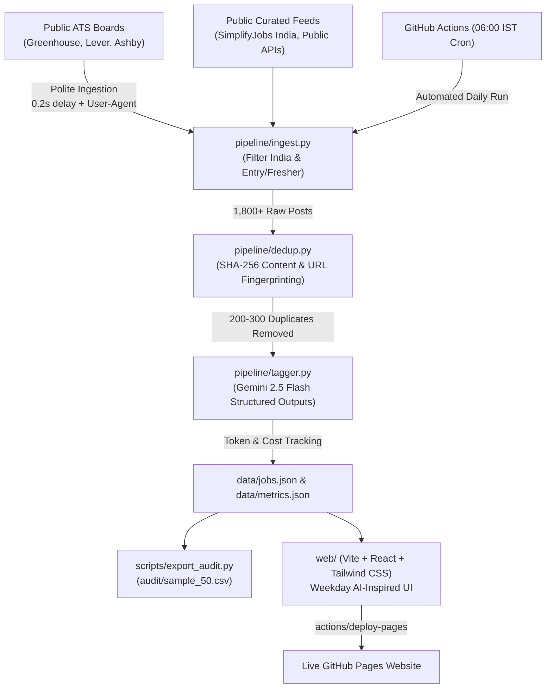

# ⚡ Beep Fresher & Internship Job Portal (Gen AI MVP)

> A live, self-updating, ToS-compliant job aggregator curating **1,600+ real fresher jobs and internships in India**, powered by **Google Gemini 2.5 Flash structured tagging** and presented in a sleek dashboard inspired by **Weekday AI**.

[](https://github.com/SNOOKEY/job-portal/actions/workflows/daily-refresh.yml)
[](https://snookey.github.io/job-portal/)
[](https://deepmind.google/technologies/gemini/)
[](LICENSE)

---

## 1. System Architecture



---

## 2. Open-Source Attribution & Architectural Lineage

This project adapts architectural patterns from two open-source initiatives:

1. **[`career-ops`](https://github.com/career-ops-hq/career-ops) (MIT License)**
   * **Borrowed Patterns:** Multi-portal job board scanning patterns (`boards-api.greenhouse.io`, `api.lever.co`, `api.ashbyhq.com`) and posting legitimacy heuristics.
   * **Excluded Elements:** Single-user CV tailoring, 1-to-5 personal fit scoring, PDF resume generation.

2. **[`dossier`](https://github.com/AienTech/dossier) (AGPL-3.0 License / Pattern Inspiration)**
   * **Borrowed Patterns:** Strict polite crawling conventions, scheduled autonomous job-agent execution flow, structured schema extraction, and clean dashboard state management.
   * **Excluded Elements:** Single-user authentication, heavy Docker/PostgreSQL database overhead, Gmail auto-drafting.

---

## 3. Gemini 2.5 Flash Tagging & Cost Tracking

### Centralized Configuration (`config/tagging_config.py`)
Classification taxonomies and normalization rules are isolated in `config/tagging_config.py` for immediate live editing:

* **Role Taxonomy:** `Software Engineering`, `Data & Analytics`, `AI / ML`, `Product`, `Design`, `DevOps / Cloud`, `QA / Testing`, `Marketing & Growth`, `Sales & BD`, `Operations & HR`, `Other`.
* **City Normalization:** `Bengaluru`, `Delhi NCR`, `Mumbai`, `Hyderabad`, `Pune`, `Chennai`, `Kolkata`, `Ahmedabad`, `Remote (India)`, `Other`.

### Deterministic JSON Schema
Every post is processed with Structured Outputs:
```json
{
  "role": "Software Engineering",
  "city": "Bengaluru",
  "job_type": "Internship | Full-Time Fresher",
  "confidence": 0.95
}
```

### Token Usage & Cost Calculator

| Metric | Formula / Rate | Actual / Projected |
| :--- | :--- | :--- |
| **Model** | `gemini-2.5-flash` | Ultra-low latency & cost |
| **Input Price** | $0.30 per 1,000,000 input tokens | $0.00000030 / token |
| **Output Price** | $2.50 per 1,000,000 output tokens | $0.00000250 / token |
| **Average Input per Post** | ~140 prompt tokens | Prompt & candidate schema |
| **Average Output per Post** | ~35 response tokens | Deterministic JSON payload |
| **Total Cost per 1,000 Posts** | `(140k * $0.30 + 35k * $2.50) / 1M` | **$0.1295 USD (~₹11.20 INR)** |
| **USD to INR Exchange Rate** | `₹86.50` | Standard reference |

*Metrics for every run are recorded directly into `data/metrics.json`.*

---

## 4. 50-Post Quality Audit Exporter

Run the audit exporter script:
```bash
python scripts/export_audit.py
```
This generates `audit/sample_50.csv` with 50 randomly sampled jobs:
```csv
id,company,title,raw_location,apply_url,llm_role,llm_city,role_correct,city_correct,notes
```
* **Audit Scoring:** Fill `1` (accurate) or `0` (inaccurate) in `role_correct` and `city_correct` to compute benchmark accuracy percentage.

---

## 5. Weekday AI-Inspired Dashboard

The frontend in `web/` provides a modern SaaS job dashboard:
* **Visual Identity:** Crisp off-white background (`#F9FAFB`), subtle borders (`#E5E7EB`), dark slate typography, clean spacing, and zero promotional noise.
* **Header & Live Refresh:** Live timestamp badge displaying the latest dataset run, total active jobs counter, and GitHub source links.
* **Sticky Search & Filtering:**
  * Instant multi-keyword search across titles, companies, skills, and locations.
  * Role taxonomy dropdown filter.
  * Metro hub city dropdown filter.
  * Job Type (Internship vs. Full-Time Fresher) filter.
  * ATS source filter (Greenhouse, Lever, Ashby, etc.).
* **AI Cost & Pipeline Drawer:** One-click modal displaying live token counts, run cost in USD/INR, projected cost per 1,000 posts, and category distributions.

---

## 6. Local Setup & Execution Guide

### Prerequisites
* Python 3.11+
* Node.js 18+ (Node 20+ recommended)
* `uv` or `pip`

### Step 1: Clone & Install Python Dependencies
```bash
git clone https://github.com/SNOOKEY/job-portal.git
cd job-portal

# Using virtualenv
python -m venv .venv
source .venv/bin/activate  # On Windows: .venv\Scripts\activate

# Install requirements
pip install -r requirements.txt
```

### Step 2: Configure Environment Variables (Optional for Local LLM Tagging)
```bash
cp .env.example .env
# Edit .env and paste your GEMINI_API_KEY
```
*(Note: If no API key is provided, the pipeline seamlessly uses the deterministic taxonomy engine with simulated token metrics so that local builds never fail).*

### Step 3: Run the Ingestion & Tagging Pipeline
```bash
python pipeline/run_pipeline.py
```
*Outputs generated:*
* `data/jobs.json` (1,600+ active unique posts)
* `data/metrics.json` (pipeline execution stats, token counts, and cost metrics)

### Step 4: Export Audit Sample
```bash
python scripts/export_audit.py
# Sample written to audit/sample_50.csv
```

### Step 5: Start the Frontend UI
```bash
cd web
npm install
npm run dev
```
Open [http://localhost:3000](http://localhost:3000) in your browser.

### Step 6: Build Production Frontend
```bash
cd web
npm run build
```

---

## 7. GitHub Actions & GitHub Pages Deployment

The automated workflow is pre-configured in `.github/workflows/daily-refresh.yml`:

1. **Push to GitHub** (Make sure the repository is **Public**).
2. Navigate to **Settings -> Secrets and variables -> Actions** -> Add `GEMINI_API_KEY`.
3. Navigate to **Settings -> Pages** -> Under **Build and deployment**, set **Source** to **GitHub Actions**.
4. Go to the **Actions** tab -> Select **Daily Beep Job Portal Refresh & Deploy** -> Click **Run workflow** to trigger the initial live deployment.
5. The cron schedule runs automatically every morning at **06:00 IST (`30 0 * * *` UTC)**.

---

## 8. License

Distributed under the MIT License. See [LICENSE](LICENSE) for details.
Attribution to `career-ops` (MIT) and `dossier` (AGPL-3.0) for crawling and data pipeline design patterns.
